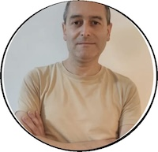

# Sobre mi

Mi nombre es Fernando Collazo, tengo 46 años y vivo en la ciudad de Libertad, en el departamento de San José.

Me interesan mucho los temas vinculados a tecnología, educación e innovación y su potencial para transformar realidades y generar nuevas oportunidades para las personas.

Durante los últimos años, he explorado diferentes áreas vinculadas con la programación, la electrónica y la cultura maker.

Actualmente trabajo en Hub San José, un espacio perteneciente a la Intendencia de San José dedicado a promover la cultura emprendedora, la innovación y la tecnología en edades tempranas.