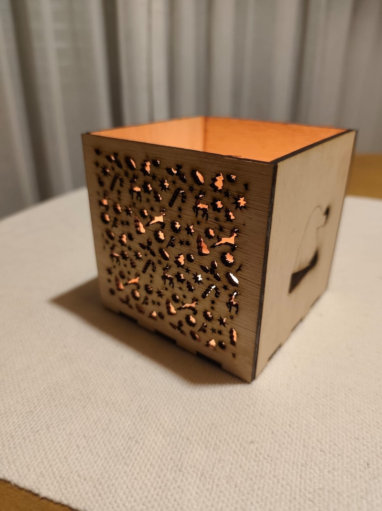
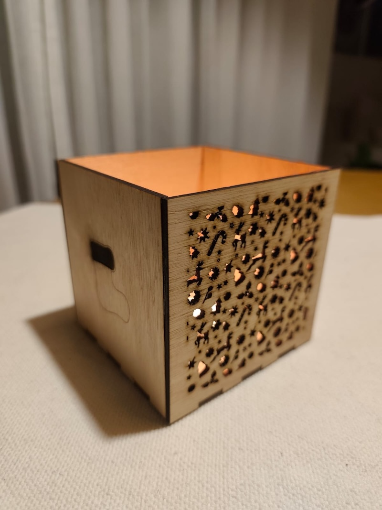
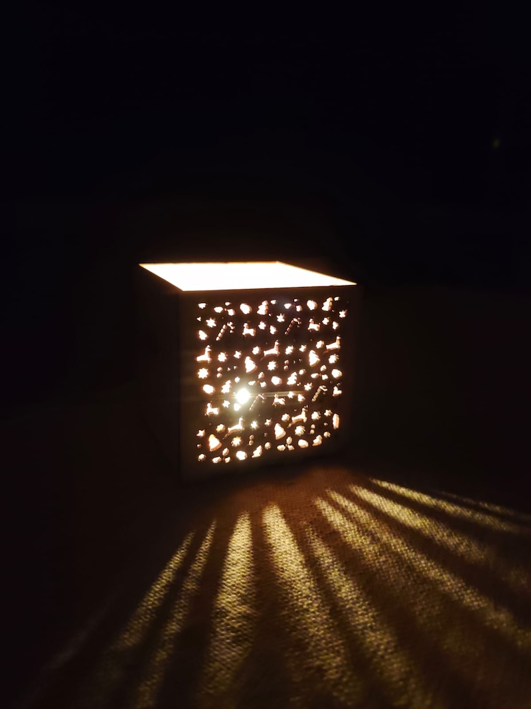
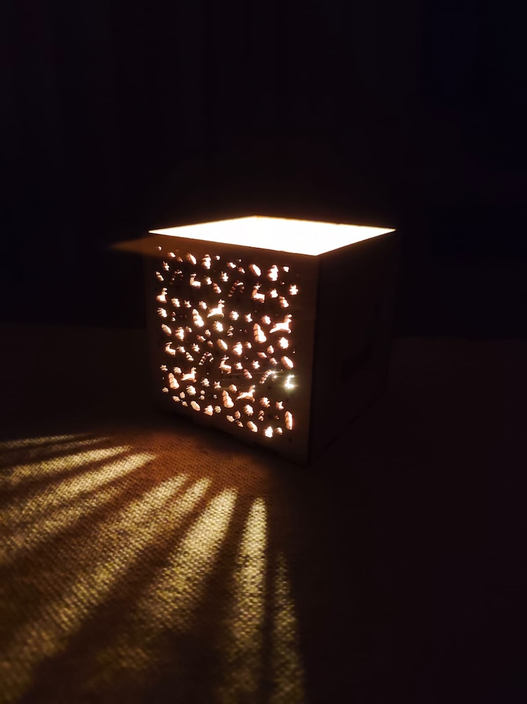

# FP01
## Primera visita al Lab

### Objetivo del módulo
Las visitas a los laboratorios tienen como objetivo aplicar de forma práctica los conocimientos adquiridos en los módulos técnicos de la Especialización.

Se realizarán tres visitas obligatorias en el marco de las unidades curriculares FP y se organizarán instancias adicionales para la fabricación de los prototipos del proyecto final.

#### Fecha de la primera visita
FP01 – Primera visita: 30 de octubre de 2026.

**Laboratorio**: Por motivos de agenda, se acordó con el equipo de UTEC realizar la práctica en el espacio de Fab Lab del Hub San José perteneciente a la Intendencia.

**Máquina utilizada**: Cortadora láser de diodo Creality Falcon2 Pro de 40W.

**Software CAM empleado**: Utilicé el software LightBurn Pro en su versión 2.0.05.

**Una reflexión personal sobre la experiencia**:
Personalmete me hubiera gustado poder realizar esta práctica en los laboratorios de UTEC, pero por motivos de agenda laborales no fue posible, teniendo que realizar la actividad en el laboratorio proporcionado en mi espacio de trabajo.

Creo que son instancias muy enriquecedoras, en donde se pueden intercambiar conocimientos y experiencias, además de la posibilidad de poder trabajar con otro tipo de máquinas más profesionales.

Espero poder estar ahí en la proxima instancia, y así poder aprovechar todas sus posibilidades que una jornada de estas características ofrece.

#### Imagen del objeto fabricado

#### Video del proceso de cortado y grabado
[Clic aquí para ver el video](https://www.youtube.com/shorts/UDTUD96AZ8Y)