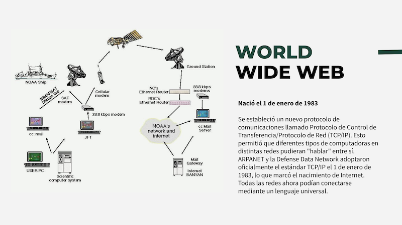
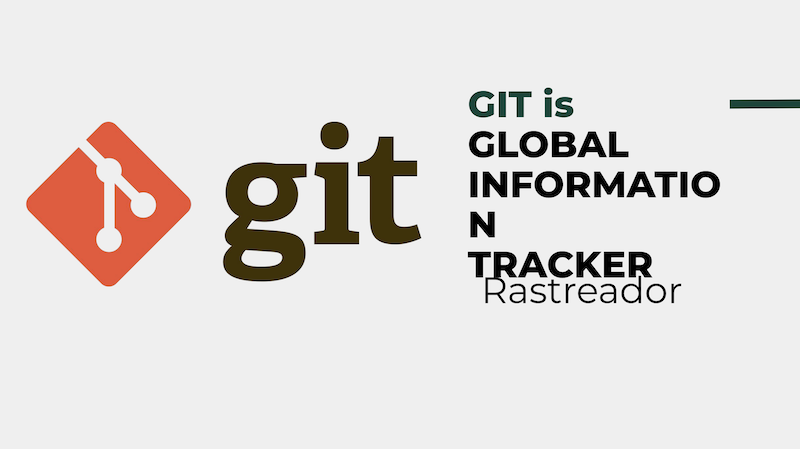
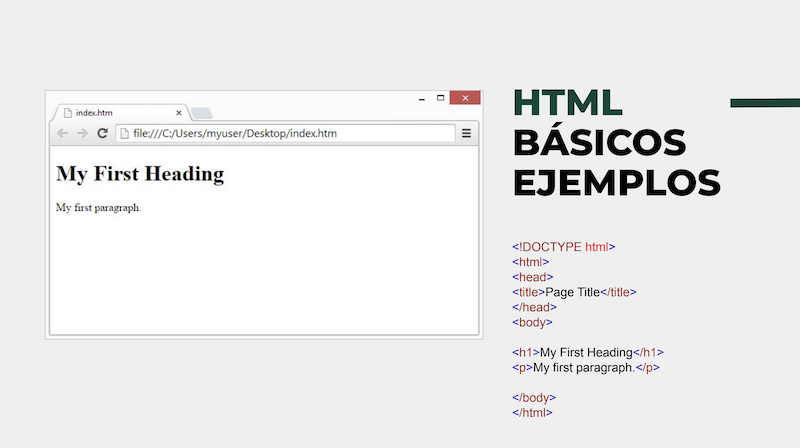
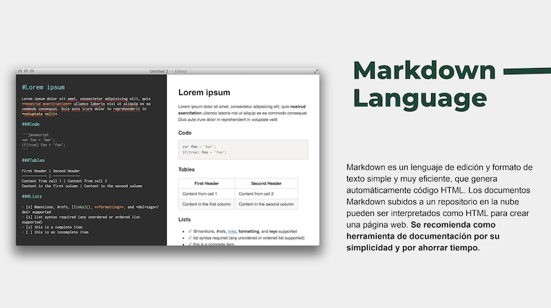
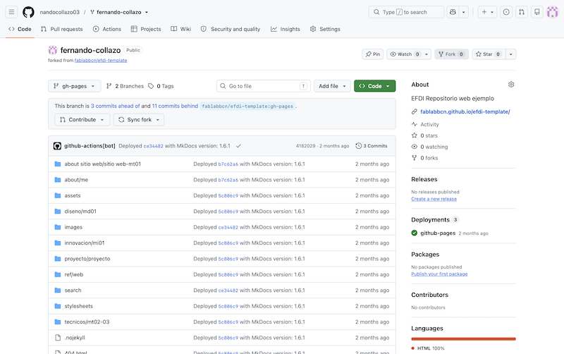

# MT01
## Introducción a herramientas digitales

### Objetivos del módulo
* Comprender los conceptos básicos de Git y GitHub.
* Crear mi propio repositorio en GitHub y publicar mi página web personal.
* Comprender los primeros pasos para utilizar tu página como espacio de documentación de proyectos.

### Herramientas digitales
Si bien cuento con alguna experiencia previa en áreas como la programación, la electrónica y la robótica educativa, entre otras, durante este módulo pude reconectar y profundizar mis conocimientos en temás como el funcionamiento de Internet, los sistemas de control de versiones, las plataformas de trabajo colaborativo, el lenguaje HTML y los editores de código.

También tuve la posibilidad de aprender a utilizar el lenguaje Markdown “_una herramienta de conversión de texto a HTML para escritores web_”, muy utilizada en sistemas de documentación de proyectos.

### Tarea final del módulo
La tarea final del módulo consistió en compartir mi página de GitHub para la documentación completando las secciones About me y About Sitio Web.

En mi caso particular no fue necesario crearme una cuenta en GitHub ya que dispongo de una desde hace un tiempo, la cual he utilizado para subir ejercicios y proyectos de otros cursos que he realizado. De cualquier manera pude repasar y aprender algunas cosas nuevas como la utilización de las **GitHub Pages**.

Inicialmente tomé la decisión de realizar mi página utilizando **HTML**, con el fin de repasar su uso. Posteriormente, consultando con el profesor del módulo y tomando sus sugerencias, resolví modificarla y realicé un fork del **efdi_template** proporcionado por **UTEC** para documentar todo mi proceso de aprendizaje.

Considero que esta ha sido una buena decisión, ya que me ha permitido ahorrar tiempo y aprender una forma de generar contenido con la que no estaba familiarizado.

