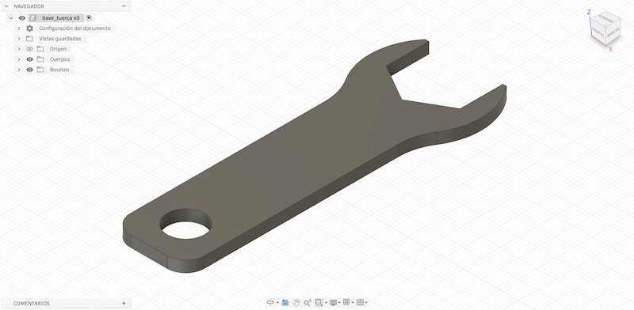
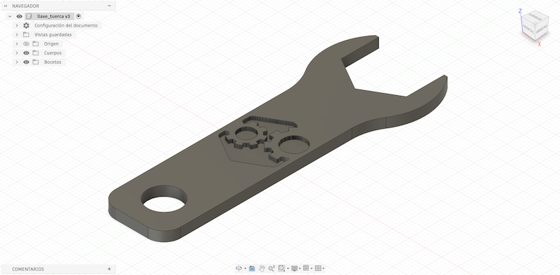
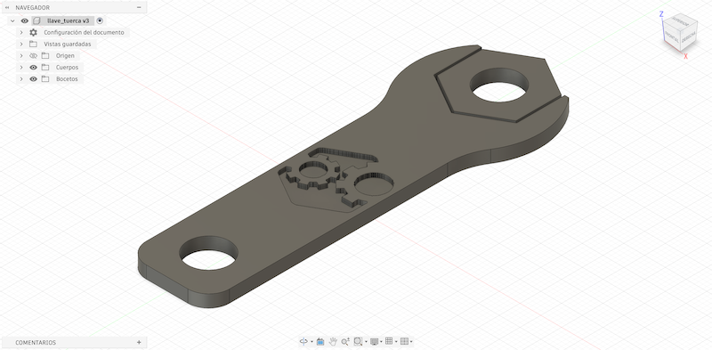

# MT02
## Diseño 2D y Modelado 3D

### Objetivos del módulo
* Comprender los conceptos, procesos y herramientas principales involucrados en la creación de diseños digitales relevantes para su posterior fabricación.

* Identificar los diferentes formatos y software de diseño, evaluando su pertinencia según el contexto y objetivos.

* Describir el flujo de trabajo general en diseño 2D y 3D aplicados a la fabricación digital.

* Integrar los diferentes procesos en el desarrollo de un ejercicio concreto, aplicándolos de forma coherente, eficiente y efectiva.

* Comunicar los procesos realizados utilizando herramientas digitales de edición y posterior presentación.

### ¿Qué hicimos en este módulo?
Durante este módulo conocimos la importancia del diseño digital como etapa fundamental de los procesos de fabricación. Exploramos diferentes herramientas del diseño 2D y modelado 3D utilizadas para transformar ideas en representaciones digitales que posteriormente se convertirán en objetos físicos.

En cuanto al diseño 2D, aprendimos sobre las diferencias entre imágenes rasterizadas (mapas de bits) y gráficos vectoriales, hablamos sobre tipos de formatos de imágenes (JPG, PNG, TIFF, PSD, RAW y SVG, etc) y conocimos herramientas para edición de imágenes y diseño vectorial.

En cuanto al modelado 3D, abordamos los conceptos generales del diseño tridimensional, las diferencias entre modelado mediante mallas poligonales (Mesh) y superficies (NURBS), las características del modelado paramétrico y sus posibilidades para desarrollar piezas y ensamblajes y conocimos herramientas de modelado 3D, como Fusion, SolidWorks, FreeCAD, Blender y Tinkercad.

### Reflexión personal
Actualmente por el trabajo que desempeño en Hub San José, utilizo algunas de las técnicas y herramientos trabajadas durante este módulo, siempre de manera muy básica y sencilla. Los diferentes contenidos abordados me permitieron ampliar la comprensión sobre algunas de mis prácticas e identificar posibles mejoras en mis procesos de trabajo.

Generalmente cuando necesito realizar un diseño 3D para imprimir, suelo utilizar TinkerCad, ya que es una herrmaienta con la que me siento bastante cómodo.

Durante el módulo se recomienda el uso de Fusion 360, (_una herramienta mucho más completa y compleja_) por lo que decidí animarme a utilizarlo para el desarrollo de la actividad final y también poco a poco para algunos diseños en mi ámbito laboral y personal.

### Tarea final del módulo
La tarea final del módulo consistió en diseñar un objeto utilitario compuesto por al menos dos piezas relacionadas y contar con un logo/ícono en relieve. Generar una lámina de presentación que contenga un título, la imagen del modelo con anotaciones y una breve descripción.

Para esta actividad realicé el diseño de dos piezas relacionadas (llave y tuerca con logo) como parte de un posible material educativo para un kit de aprendizaje de habilidades STEAM.

Elegí estas dos piezas porque mi idea de proyecto final tiene relación con la creación de material educativo enfocado en el desarrollo de habilidades STEAM, y a su vez, era un diseño que sentía que podía realizar a pesar de mi poca experiencia con Fusion 360, siendo esta una oportunidad para prácticar y seguir aprendiendo a utilizar la herramienta.

Durante el desarrollo del diseño necesité ir hacia atrás y adelante varias veces hasta conseguir el resultado que deseaba. También tuve algunas dificultades al momento de colocar la figura del logo, ubicándola correctamente en la pieza y asegurandome de que todas las formas que necesitaba extruir estuvieran cerradas.

### Imágenes del proceso

### Archivos para descargar
[Clic aquí para descargar los archivos de la actividad](https://drive.google.com/drive/folders/1-NEu4cxgFmVUA_JlXEWCGd8j1nBwnY31?usp=sharing)