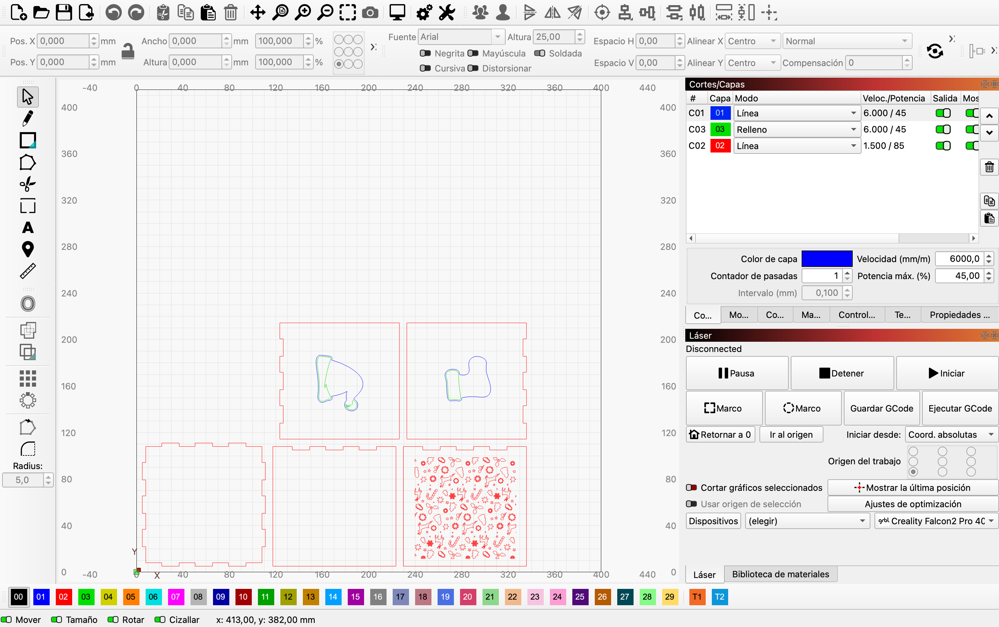
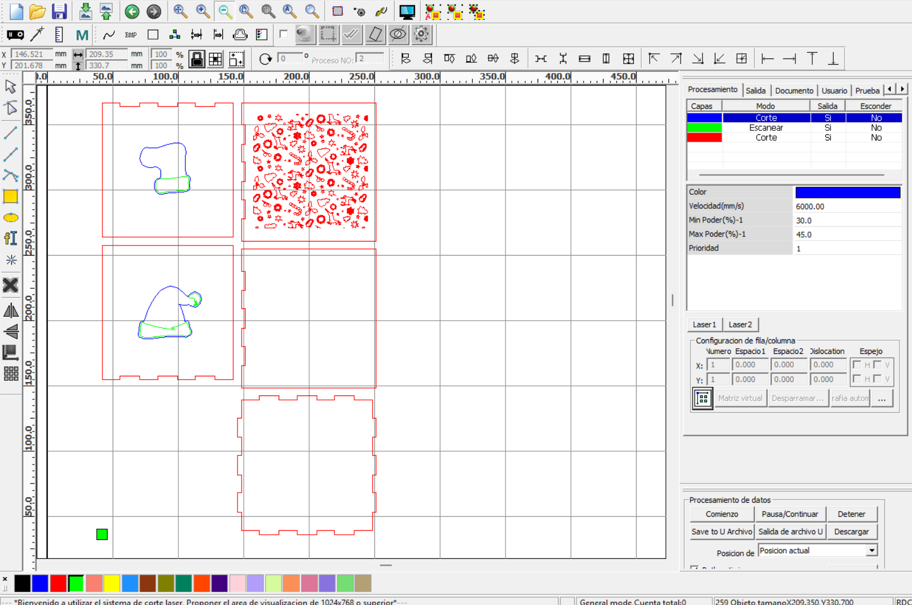

# MT03
## Corte láser controlado por computadora

### Objetivos del módulo
* Profundizar en los conocimientos de diseño 2D aplicados a fabricación digital.

* Comprender los procesos involucrados en el funcionamiento y uso de la cortadora láser.

* Comprender los requerimientos, limitantes y situaciones de uso de esta tecnología.

### ¿Qué hicimos en este módulo?
Durante este módulo analizamos las posibilidades que ofrece el corte láser como herramienta de fabricación digital, su funcionamiento y las etapas necesarias para transformar un diseño digital en un objeto físico.

Conocimos los fundamentos del diseño paramétrico y generativo, las herramientas de diseño y los procesos de fabricación asistida por computadora.

También estudiamos los componentes de una cortadora láser, los diferentes tipos de tecnologías láser, las características de los materiales y los parámetros que permiten controlar las operaciones de corte, grabado y marcado.

### Reflexión personal
Uno de los temas que me interesó especialmente de lo trabajado en este módulo fue el modelado paramétrico a través de Fusion 360. En mi trabajo cada vez que necesité realizar un diseño para corte láser, dibujaba el diseño directamente en un software 2D como LightBurn.

Generalmente esto me ha traído dificultades al momento hacer coincidir todas las piezas y en ocaciones he tenido que reconstruir los modelos para poder modificar su tamaño.

Esta es una técnica que desconocía y considero que si bien aún necesito mucha práctica, me ayudará en un futuro a conseguir mejores resultados en mi trabajo.

### Tarea final del módulo
La tarea final del módulo consistió en diseñar la carcasa de una luminaria para ser fabricada mediante corte láser, utilizando exclusivamente piezas laminares unidas mediante encastres, sin adhesivos ni otros elementos de unión.

Para esta actividad realicé el diseño de una veladora (_en forma de cubo_) con motivos navideños. El diseño incluyó una imagen de un patrón de figuras caladas al frente y un marcado y grabado a los costados con los dibujos de una bota y un gorro.

Esta actividad incluyó el uso de un conjunto de acciones en Fusion 360, (_parametrización, holguras, etc_) las cuales desconocía o tengo muy poca experiencia en su uso, por lo que resultó un verdadero desafío para mí.

Al igual que en prácticas anteriores, durante el desarrollo del diseño necesité ir hacia atrás y adelante varias veces hasta conseguir el resultado deseado. Si bien para esta actividad fue más sencillo colocar las imágenes en el diseño que la vez anterior, encontré alguna dificultad para centrar correctamente las figuras en las caras de la veladora, ya que lo hice de manera manual porque aún no tengo claro cómo alinear automáticamente un elemento respecto de otro.

Otra dificultad que se presentó casi finalizando la actividad, fue que al momento de organizar el modelo para exportar los archivos DXF para su posterior preparacíon, la opción "Organizar" de Fusion 360 no estaba habilitada. He estado trabajando con la versión de uso personal del programa y desconocía que no disponía de esa funcionalidad.

Llegado a este punto, intenté activar la versión de prueba por 30 días, pero al momento de la activición el programa se cerró y cuando lo volví a abrir continuaba en la versión de uso personal y sin mostrar la posibilidad de activar la versión de prueba.

Debido a esta dificultad y como disponía de poco tiempo para la entrega, decidí rehacer el diseño 2D de las piezas directamente en LightBurn para poder cumplir con el cronograma.

Luego de esto me comuniqué con el docente del módulo para comentarle la situación y solicitar apoyo técnico para poder activar el programa y completar la tarea directamente desde Fusion 360.

Finalmente pude completar la tarea desde Fusion 360 y exportar correctamente los archivos para su preparación, corte y grabado.

Como mencioné anteriormente, para preparar el modelo para su posterior corte y grabado utilicé LightBurn, ya que es el programa que tengo instalado para mi trabajo.

De cualquier manera, probé instalar el programa sugerido en el módulo (RD Works) en una computadora con Windows para conocer un poco su funcionamiento.

### Imágenes
#### Primera versión

#### Versión final

#### Software CAM

### Archivos para descargar
[Clic aquí para descargar los archivos de la actividad](https://drive.google.com/drive/folders/1Vxi-u36zJInVPxIdUAZY4Nv8LT-CZ06G?usp=sharing)